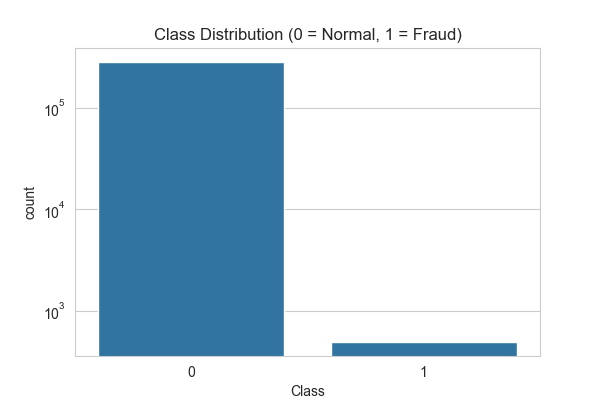
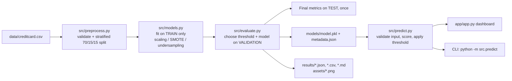

# Beyond Accuracy: Credit Card Fraud Detection under Severe Class Imbalance

A fraud-detection project built around one idea: on this dataset a model can score **99.8 % accuracy while catching no fraud at all**. The repository shows how to evaluate and choose a model honestly when only ~0.17 % of transactions are positive: a leakage-free split, comparable experiments, a decision threshold chosen on validation data, explicit false-alarm vs. missed-fraud trade-offs, and a dashboard that lets you move the threshold and see the consequences.

> **Latest verified run:** The results below were generated by running `python -m src.train` on the full 284,807-row dataset. The selected model is unweighted XGBoost, chosen by validation average precision. The dataset itself is not distributed with this repository; see [Dataset](#dataset) and [Reproducibility](#reproducibility) to reproduce the run.

## Contents
[Problem](#the-problem) · [Features](#key-features) · [Dataset](#dataset) · [Architecture](#architecture) · [Structure](#repository-structure) · [Setup](#setup) · [Usage](#usage) · [Imbalance & thresholds](#class-imbalance-and-threshold-selection) · [Results](#results) · [Dashboard](#dashboard) · [Reproducibility](#reproducibility) · [Limitations](#limitations-bias-and-responsible-use) · [Deployment](#deployment) · [Troubleshooting](#troubleshooting) · [Future work](#future-improvements)

## The problem

Only 492 of 284,807 transactions (0.173 %) in the dataset are fraudulent. A "model" that always answers *legitimate* is 99.83 % accurate and useless. Accuracy therefore says almost nothing here; what matters is how many frauds are caught (recall), how many alerts are real (precision), and what each kind of error costs.



## Key features

- **Leakage-safe protocol:** one stratified 70/15/15 train/validation/test split (seed 42) shared by every experiment; scaling and resampling are fitted on training rows only; the test split is touched once, for final reporting.
- **Five comparable experiments:** logistic regression baseline, XGBoost without handling, class-weighted XGBoost, SMOTE and random undersampling (identical hyper-parameters, so only imbalance handling differs).
- **Validation-based decisions:** model selection uses validation average precision. Each model's decision threshold is selected using validation data, with the default rule choosing the highest recall subject to precision ≥ 0.80.
- **Machine-readable outputs:** metadata (threshold, feature order, library versions, dataset hash), per-experiment metrics, a threshold curve, and regenerated figures.
- **Reliable inference:** `src/predict.py` validates schema, dtypes and values, restores feature order, and raises specific exceptions; the dashboard and CLI both use it.
- **Streamlit dashboard:** upload or sample data, live threshold slider, counts, sorted results, CSV export, threshold/cost explorer.
- **Automated tests and CI:** pytest suite on a small synthetic dataset (no retraining on real data needed) and a GitHub Actions workflow.

## Dataset

The dataset is **not included**. It is the "Credit Card Fraud Detection" dataset (European cardholders, September 2013; Worldline and ULB Machine Learning Group, published on Kaggle): 284,807 rows, `Time`, `V1`–`V28` (PCA components), `Amount`, and `Class` (1 = fraud). Download it from its owner, check its terms, and place it at `data/creditcard.csv` (or set `BEYONDACCURACY_DATA_PATH`). Details: [`data/README.md`](data/README.md). CSV files in `data/` are git-ignored.

## Architecture



## Repository structure

```text
├── app/app.py                    # Streamlit dashboard (uses src.predict)
├── src/
│   ├── config.py                 # paths (cwd-independent, env-overridable) and constants
│   ├── preprocess.py             # dataset loading/validation, shared train/val/test split
│   ├── models.py                 # the five experiments
│   ├── evaluate.py               # metrics, threshold selection, threshold table, costs
│   ├── plots.py                  # figures generated from the actual experiment
│   ├── train.py                  # python -m src.train
│   └── predict.py                # artifact loading, input validation, scoring, CLI
├── tests/                        # pytest suite (synthetic data; see tests/synthetic.py)
├── notebooks/                    # 01 EDA · 02 baselines · 03 imbalance · 04 evaluation · 05 SHAP
├── models/metadata.json          # saved threshold + feature schema (model.pkl is generated, git-ignored)
├── results/                      # metrics and reports written by training
├── assets/                       # figures (assets/legacy/ = archived figures from the old protocol)
├── data/README.md                # how to obtain the dataset (the CSV itself is git-ignored)
├── .github/workflows/ci.yml      # runs pytest on push / pull request
├── .streamlit/config.toml        # upload size limit, no telemetry
├── requirements.txt              # runtime dependencies
├── requirements-dev.txt          # tests + notebooks
└── requirements-tested.txt       # exact versions the suite last passed with
```

Notebooks 01 and 02 are the original exploratory analyses (80/20 split, no validation set) and are kept as they were. Notebooks 03–05 were rebuilt on the shared protocol and ship without stored outputs: run them to generate results.

## Setup

```bash
git clone https://github.com/Dhruv2-lang/BeyondAccuracy.git
cd BeyondAccuracy
python3 -m venv .venv
source .venv/bin/activate                  # Windows: .venv\Scripts\activate
pip install -r requirements-dev.txt        # or requirements.txt for training + dashboard only
# then place the dataset at data/creditcard.csv (see Dataset)
```

Python 3.11 or 3.12 is recommended (what CI uses). `requirements-tested.txt` lists the exact versions the test suite last passed with, in case you need to pin them: `pip install -r requirements-tested.txt`.

## Usage

All commands run from the repository root; paths are resolved relative to the repository, so the working directory does not matter for the scripts themselves.

```bash
python -m src.train                        # run all experiments, select model, write artifacts
python -m src.train --experiments xgb_weighted logreg_baseline
python -m src.train --final-model xgb_weighted     # force the saved model
python -m src.train --n-estimators 50 --no-plots   # quick smoke run

python -m src.predict --input data/sample_transactions.csv --output results/scored.csv
python -m src.predict --input my_transactions.csv --threshold 0.30

streamlit run app/app.py                   # dashboard
python -m pytest                           # tests
jupyter lab                                # notebooks (pip install jupyterlab first)
```

`python -m src.train` writes `models/model.pkl`, `models/metadata.json`, `results/final_test_metrics.json`, `results/experiment_results.json`, `results/experiment_summary.md`, `results/threshold_curve_validation.csv`, and `assets/{precision_recall_curve,threshold_tradeoff,confusion_matrix,model_comparison}.png`. If a model already exists it is first copied to `models/previous/` rather than overwritten blindly.

## Class imbalance and threshold selection

**Why not accuracy or ROC-AUC alone.** With 0.17 % positives, accuracy is dominated by the legitimate class. ROC-AUC can also look excellent because the false-positive *rate* divides by hundreds of thousands of legitimate transactions; precision-recall metrics (average precision, precision, recall, F1) measure the fraud class directly.

**Imbalance strategies compared** (training data only): class weighting (`scale_pos_weight`), SMOTE (oversampling in standardised space, mapped back to raw units) and random undersampling, each against unweighted XGBoost and a scaled logistic-regression baseline.

**The threshold is a business decision, not a constant.** A model outputs a probability; the threshold turns it into an alert.

- Lower threshold → more fraud caught (higher recall), but more false alarms and review work.
- Higher threshold → fewer false alarms (higher precision), but more fraud missed.

The default rule picks the **highest validation recall subject to precision ≥ 0.80**; if no threshold reaches that precision it falls back to the best validation F1. The rule and the threshold are stored in `models/metadata.json`. Costs can be made explicit with `--cost-fp` / `--cost-fn` (defaults of 5 and 100 are **placeholders, not measured values**) and in the dashboard's Threshold Explorer.

**About the earlier threshold of ≈ 0.003.** An earlier notebook selected a threshold on the test set of an 80/20 split with a different model, producing ≈ 0.003. That was test-set tuning in a different experiment, not a threshold for the current pipeline. The current saved model is `xgb_unweighted`, with threshold ≈ 0.0862 selected on validation data. Historical figures are archived in `assets/legacy/`; current plots are regenerated by `python -m src.train`.

## Results

### Latest verified run — unweighted XGBoost

The full pipeline was run on the 284,807-row dataset using a stratified 70/15/15 train/validation/test split (seed 42). Model selection used **validation average precision**; the decision threshold was selected using validation data only. The test split was reserved for final evaluation.

| Metric | Result |
|---|---:|
| Selected model | `xgb_unweighted` |
| Selection criterion | Highest validation average precision |
| Validation average precision | 0.8243 |
| Selected threshold | 0.0862 |
| Test rows / fraud cases | 42,722 / 74 |
| Test precision | 84.3% |
| Test recall | 79.7% |
| Test F1 | 81.9% |
| Test average precision | 0.8367 |
| Test ROC-AUC | 0.9685 |
| Test accuracy | 99.94% |
| Confusion matrix | TP 59 · FP 11 · FN 15 · TN 42,637 |

At the selected threshold, the model detected 59 of 74 fraud cases and missed 15, while generating 11 false alarms.

**Why unweighted XGBoost was selected:** it achieved the highest validation average precision (0.8243), narrowly ahead of class-weighted XGBoost (0.8223). The weighted model scored slightly better on the test split, but test metrics were not used to select the model. This preserves the separation between model selection and final evaluation.

With only 74 fraud cases in the test split, precision, recall and the selected threshold are statistically noisy; results can vary across samples.

### Full model comparison

Run `python -m src.train`; it writes `results/experiment_summary.md` (test-set precision, recall, F1, average precision, ROC-AUC, confusion counts and illustrative costs for each experiment, with thresholds chosen on validation data) and `assets/model_comparison.png`. The saved model is the experiment with the best **validation** average precision unless `--final-model` is given.

<details>
<summary>Earlier exploratory comparison (80/20 split, default 0.5 threshold, no validation set) — historical, not the verified protocol</summary>

These figures came from the original notebooks, which evaluated on a single test split at the default threshold. They illustrate the accuracy trap and the precision/recall trade-off of each technique, but are not comparable with the protocol above.

| Model | Accuracy | Fraud recall | Fraud precision |
|---|---|---|---|
| Baseline (no handling) | 99.95 % | 80.0 % | 90.0 % |
| Class weighting | 99.95 % | 82.7 % | 87.1 % |
| SMOTE | 99.93 % | 85.7 % | 77.1 % |
| Undersampling | 95.50 % | 91.8 % | 3.4 % |

Undersampling had the highest recall but ~97 % of its alerts were false alarms, which is why recall alone is a trap.
</details>

### Explainability

Notebook `05_finalize_model` runs SHAP on the **saved** model (XGBoost only) using validation rows. Earlier SHAP plots in `assets/legacy/` described a different model. SHAP shows how the model uses inputs, not why fraud occurs, and `V1`–`V28` are anonymised PCA components.

## Dashboard

`streamlit run app/app.py` provides:

- CSV upload with validation and clear error messages (missing/extra columns, non-numeric, NaN/∞, empty file, row limit of 200,000). A `Class` column, if present, is removed before scoring and used only to show how the current threshold performed on your labels.
- **Try with sample data:** uses `data/sample_transactions.csv` if present, otherwise draws 500 transactions (20 known frauds + 480 legitimate) from `data/creditcard.csv`.
- A threshold slider initialised from `models/metadata.json`, with a reset button. Moving it re-classifies instantly from stored probabilities: the model is not retrained or re-run.
- Totals, flagged/not-flagged counts, flag rate, results sorted by fraud probability, and CSV download.
- **Threshold Explorer:** precision, recall, false alarms and missed frauds on the validation set at the chosen threshold, an editable cost model, a precision/recall chart, and the generated figures.
- A persistent warning that a model score is not proof of fraud.

No dashboard screenshots are committed; run the app to see it. If the model, threshold curve or figures are missing, the app says what to run instead of crashing.

## Reproducibility

- **Seeds/config:** `RANDOM_STATE = 42`, split 70/15/15, precision target 0.80 (`src/config.py`); XGBoost hyper-parameters are stored in `results/experiment_results.json`.
- **Metadata** (`models/metadata.json`): records selected experiment, model type, validation-selected threshold and rule, feature names and order, target column, random seed, split configuration, dataset SHA-256 and row count, and library versions.
- **Determinism:** the test suite checks that two training runs give identical metrics; results may still differ slightly across XGBoost/scikit-learn versions or hardware.
- **Pickle caution:** `model.pkl` is a joblib pickle. Only load model files you trained or trust, and retrain if loading fails after a library upgrade.
- **Notebooks** read data through `src.config` and run when started from `notebooks/` or the repository root; set `BEYONDACCURACY_QUICK=1` for a fast smoke run.

## Limitations, bias and responsible use

- **Anonymised features:** `V1`–`V28` are PCA outputs, so business interpretability is limited and no fairness analysis by customer group is possible; the dataset contains no demographic attributes, so absence of measured bias is not evidence of fairness.
- **Narrow data:** two days of 2013 European card transactions. Fraud patterns drift; real deployments need monitoring and retraining.
- **Random split of time-ordered data:** a time-based split would give a more realistic estimate of future performance. `Time` is seconds since the first transaction in this two-day window and may not generalise.
- **Few positives:** ~74 test and ~74 validation frauds make metrics and the selected threshold statistically noisy.
- **No hyper-parameter tuning** and no probability calibration; resampled models give distorted probabilities (the validation threshold compensates but does not calibrate).
- **Cost assumptions** in the code and dashboard are placeholders.
- **Responsible use:** this is an educational project, not a production fraud system. Flags should trigger human review, not automatic adverse action, and false alarms burden legitimate customers.

## Deployment

The app targets Streamlit Community Cloud. It has **not** been deployed or verified there.

1. Run `python -m src.train` locally so these exist: `models/model.pkl`, `models/metadata.json`, `results/threshold_curve_validation.csv`, `assets/*.png`.
2. `models/*.pkl` is git-ignored. A model you trained yourself can be committed deliberately with `git add -f models/model.pkl` (a 500-tree depth-4 XGBoost pickle was about 0.7 MB on synthetic data; check your file's size). Never commit the dataset.
3. Push, create the app at share.streamlit.io, set the main file path to `app/app.py`, choose Python 3.11 or 3.12, and let it install `requirements.txt` from the repository root.
4. Without `data/creditcard.csv` on the server, sample mode will report that no sample is available. Add a small `data/sample_transactions.csv` (force-add with `git add -f`) only if you are permitted to redistribute those rows.

No secrets are required or read by the app. Uploads are processed in memory and limited to 50 MB (`.streamlit/config.toml`) and 200,000 rows.

## Troubleshooting

| Symptom | Fix |
|---|---|
| `Dataset not found: …/data/creditcard.csv` | Place the dataset there or set `BEYONDACCURACY_DATA_PATH` (see `data/README.md`). |
| Dashboard says "The model could not be loaded" / `Model file not found` | Run `python -m src.train`; the model binary is not in Git. |
| `Could not load model … different library version` | Retrain with `python -m src.train` in your current environment. |
| `ModuleNotFoundError: No module named 'src'` | Run commands from the repository root using `python -m src.train` (not `python src/train.py`). |
| `Unexpected column(s): […]` / `Missing required feature column(s)` | The CSV must have exactly the model's feature columns (plus optional `Class` in the dashboard); see the dashboard sidebar for the order. |
| Notebook 05 says the saved model isn't XGBoost | If you intentionally want to force the weighted model, run `python -m src.train --final-model xgb_weighted`; otherwise rerun `python -m src.train` to select by validation average precision. |
| Port already in use | `streamlit run app/app.py --server.port 8502` |

## Future improvements

- Time-based train/validation/test split and rolling evaluation.
- Cross-validated threshold selection and confidence intervals for metrics.
- Hyper-parameter search under the same protocol; probability calibration.
- Cost-sensitive learning with real operating costs; alert-budget thresholds.
- Drift monitoring and a model card; fairness analysis on data with customer attributes.
- Committed dashboard screenshots and a verified hosted demo.
